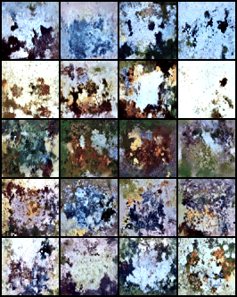
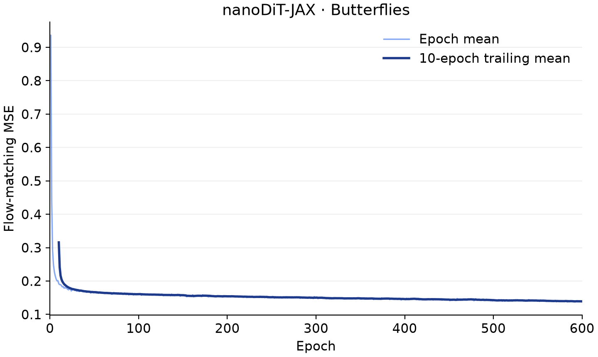

# nanoDiT-JAX

JAX/Flax port of [nanoDiT](https://github.com/sayakpaul/nanoDiT), with architecture adapted from [DiT](https://github.com/facebookresearch/DiT). Class-conditional, pixel-space rectified flow on [butterflies](https://huggingface.co/datasets/sayakpaul/butteflies_with_classes).

Targets one v6e TPU on Google Cloud or Colab. Uses bf16 computation, float32 parameters and optimizer state, gradient accumulation, host prefetching and optional activation checkpointing.

[Open the miniature Colab notebook](https://colab.research.google.com/github/sayakpaul/nanoDiT-JAX/blob/main/nanoDiT_JAX.ipynb): 10-epoch demo, sample previews, checkpoint resume and a full-run option.



Live-weight samples every 10 epochs, from the completed 600-epoch run.

## Inference

[Final checkpoint on Hugging Face](https://huggingface.co/sayakpaul/nanoDiT-JAX-butterflies). After installing the dependencies below:

```bash
.venv/bin/python inference.py --class-ids 0 1 2 3 4 --samples-per-class 4 --output runs/generated.png
.venv/bin/python inference.py --list-classes
```

Downloads the final EMA weights automatically; defaults to 150 Euler steps, CFG 5 and seed 43. The Hub also contains `checkpoint.msgpack` with live weights, EMA, optimizer and RNG state for resuming training. The Colab notebook includes a pretrained inference cell.

## Google Cloud

On a v6e-1 TPU VM (`ct6e-standard-1t`, Python 3.12):

```bash
git clone https://github.com/sayakpaul/nanoDiT-JAX.git
cd nanoDiT-JAX
uv venv --python 3.12
uv pip install --python .venv/bin/python -r requirements.txt
bash scripts/run_gcp.sh
```

The launcher downloads the dataset, benchmarks microbatch/checkpointing settings, then trains from scratch or resumes `runs/full/latest.msgpack`. Run it under a persistent service or terminal session.

Matches the [original training recipe](https://github.com/sayakpaul/nanoDiT/blob/734008c/train.py): 129.6M parameters, 64×64 images, batch 128, 600 epochs (30,000 updates), AdamW at `1e-4`, weight decay `0.01`, no warmup or gradient clipping. Samples every 10 epochs use 150 Euler steps and CFG 5; checkpoints are saved every 25 epochs. Additional EMA sample grids are saved separately.

`runs/full/` contains metrics, PNG/SVG loss plots, intermediate samples and the latest resumable checkpoint. To mirror artifacts to a local checkout and stop the VM after retrieving the final checkpoint:

```bash
python scripts/watch_gcp.py --project PROJECT_ID --zone ZONE --vm VM_NAME
```

The watcher must remain running locally. It copies the latest plots and sample grids into `assets/`. The VM's persistent disk retains all outputs.

EMA copies the first trained weights, then ramps its decay up to `0.999`. To replace an older EMA when resuming, run `bash scripts/run_gcp.sh --reset-ema` once; model weights, optimizer state and data position are restored normally. The reset is recorded in `events.jsonl`.

## Colab CLI

```bash
uv venv --python 3.12
uv pip install --python .venv/bin/python google-colab-cli==0.7.5
.venv/bin/python scripts/colab.py setup
.venv/bin/python scripts/colab.py train --download --epochs 600 --sample-ema
.venv/bin/python scripts/colab.py fetch
.venv/bin/python scripts/colab.py stop
```

Complete Google sign-in when prompted. Fetch outputs before stopping; Colab storage is temporary. Training options: `python train.py --help` in the TPU environment.

## Training progress

Measured epoch-mean loss over 600 epochs; the darker line is a 10-epoch trailing mean. Regenerate with `python plot_loss.py runs/gcp/full/metrics.jsonl --output-dir assets`.


